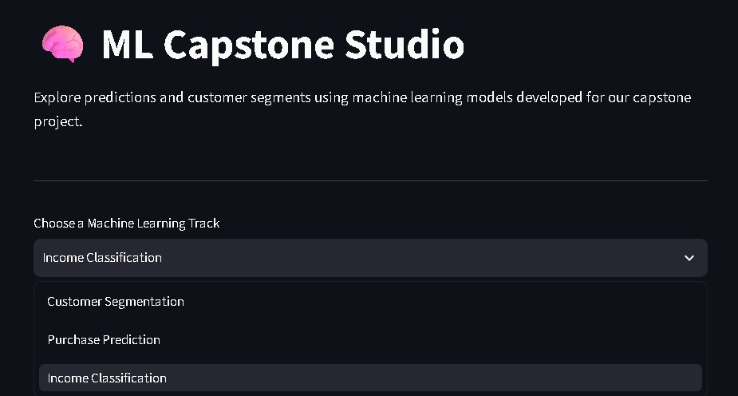
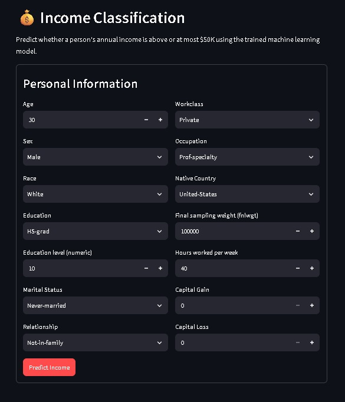
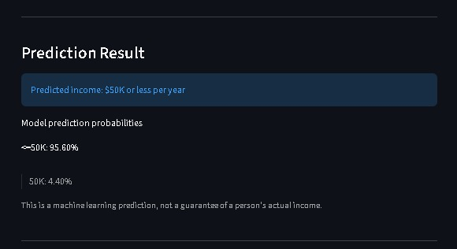

# 🧠 ML Capstone Studio

**An End-to-End Machine Learning Project: Regression, Classification and Clustering**

ML Capstone Studio is a machine learning project developed as part of the **23CSE301 — Machine Learning Capstone Project** for the academic year 2026–2027. It combines three machine learning tracks with an interactive web application built using Streamlit.

🌐 **Live Application:** [ML Capstone Studio](https://ml-capstone-studio.streamlit.app/)

## 📌 Project Overview

The project explores how machine learning can be applied to retail purchasing data, income classification, and customer segmentation.

It covers data exploration, preprocessing, feature engineering, model training, performance evaluation, hyperparameter tuning, visualization, and deployment.

### Project Objectives

- Analyze real-world datasets using exploratory data analysis.
- Apply appropriate preprocessing and feature engineering techniques.
- Train and compare multiple machine learning algorithms.
- Evaluate models using suitable metrics for each task.
- Identify useful patterns in customer purchasing behavior.
- Provide an interactive interface for exploring predictions and customer segments.

## 📸 Application Screenshots

### 1. ML Capstone Studio — Home Page



The homepage allows users to choose among Customer Segmentation, Purchase Prediction, and Income Classification.

### 2. Income Classification — Input Form



Users can enter demographic, education, employment, and financial attributes for an income prediction.

### 3. Income Classification — Prediction Result



The application displays the predicted income category and the model's prediction probabilities.

## 🌐 Live Demo

Try the deployed application here:

**[Open ML Capstone Studio](https://ml-capstone-studio.streamlit.app/)**

The application provides a web interface for interacting with the implemented machine learning models. Predictions are estimates produced by the trained models and are not guarantees of real-world outcomes.

## 📊 Machine Learning Tracks

| Track | Dataset | Objective |
|---|---|---|
| Regression | Black Friday Sales | Predict customer purchase amounts |
| Classification | Adult Income | Predict whether annual income exceeds $50K |
| Clustering | Online Retail II | Discover groups of customers with similar purchasing behavior |

### 1. Regression — Black Friday Sales

**Objective:** Predict purchase amounts using customer and product-related attributes.

The dataset contains 550,068 records and 12 columns.

**Workflow**
- Explore customer, product, and purchase attributes.
- Preprocess numerical and categorical features.
- Scale numerical features where appropriate.
- Train and compare ten regression algorithms.
- Tune selected models and evaluate their performance.

**Algorithms**
1. Linear Regression
2. Ridge Regression
3. Lasso Regression
4. ElasticNet Regression
5. Polynomial Regression
6. Decision Tree Regressor
7. Random Forest Regressor
8. Gradient Boosting Regressor
9. Support Vector Regressor (SVR)
10. K-Nearest Neighbors Regressor

**Evaluation metrics:** R², RMSE, and MAE.

### 2. Classification — Adult Income

**Objective:** Predict whether a person's annual income is `<=50K` or `>50K` based on demographic and employment-related attributes.

The dataset initially contains 32,561 records and 15 columns. After duplicate removal, 32,537 records remain.

**Workflow**
- Examine the target distribution and feature relationships.
- Handle missing values and duplicates.
- Investigate and treat outliers.
- Engineer the `capital.net` feature.
- Encode categorical features and scale numerical features.
- Split the data into training and testing sets using an 80:20 stratified split.
- Train, compare, and tune classification algorithms.

**Algorithms**
1. Logistic Regression
2. K-Nearest Neighbors (KNN)
3. Gaussian Naive Bayes
4. Decision Tree Classifier
5. Support Vector Machine (SVM)
6. Random Forest Classifier
7. AdaBoost Classifier
8. Gradient Boosting Classifier
9. Bagging Classifier
10. Multi-Layer Perceptron (MLP)

**Evaluation metrics:** Accuracy, Precision, Recall, weighted F1-score, Confusion Matrix, and ROC-AUC.

#### Classification Results

The following table summarizes the recorded test-set results from the classification notebook.

| Model | Accuracy | Weighted F1 | ROC-AUC |
|---|---:|---:|---:|
| Gradient Boosting | 0.8417 | 0.8359 | 0.8908 |
| MLP | 0.8347 | 0.8310 | 0.8887 |
| Logistic Regression | 0.8341 | 0.8276 | 0.8833 |
| SVM | 0.8350 | 0.8273 | 0.8648 |
| Bagging | 0.8325 | 0.8267 | 0.8845 |
| Decision Tree | 0.8279 | 0.8250 | 0.8700 |
| AdaBoost | 0.8317 | 0.8239 | 0.8826 |
| KNN | 0.8225 | 0.8214 | 0.8572 |
| Random Forest | 0.8196 | 0.8144 | 0.8619 |
| Gaussian Naive Bayes | 0.5174 | 0.5311 | 0.7132 |

**Selected model: Gradient Boosting Classifier**

Gradient Boosting was selected based on its weighted F1-score of **0.8359**, accuracy of **0.8417**, and ROC-AUC of **0.8908**. Weighted F1-score is useful for comparing performance when the target classes are imbalanced.

### 3. Clustering — Online Retail II

**Objective:** Discover customer segments based on purchasing behavior.

The original dataset contains 1,067,371 transaction records and 8 columns. The notebook engineers customer-level features for clustering.

**Features used**
- Frequency
- Monetary
- TotalQuantity
- AveragePrice
- Recency

The clustering notebook uses a training set of 4,702 customers and a test set of 1,176 customers.

**Algorithms**
1. K-Means Clustering
2. Agglomerative Hierarchical Clustering

**Evaluation metrics**
- Silhouette Score
- Davies–Bouldin Index
- Calinski–Harabasz Index

**Visualizations:** Elbow curve, dendrogram, PCA-based cluster visualization, and t-SNE visualization.

#### Clustering Results

| Metric | K-Means | Agglomerative |
|---|---:|---:|
| Silhouette Score | 0.3290 | 0.3036 |
| Davies–Bouldin Index | 0.9407 | 0.9044 |
| Calinski–Harabasz Index | 2292.6794 | 1986.4609 |

K-Means achieved the higher Silhouette Score and Calinski–Harabasz Index, while Agglomerative Clustering achieved the lower Davies–Bouldin Index. These metrics offer complementary ways to evaluate cluster quality.

## 🛠️ Technologies Used

- **Language:** Python
- **Data processing:** Pandas, NumPy
- **Machine learning:** Scikit-learn
- **Model persistence:** Joblib
- **Visualization:** Matplotlib and Seaborn
- **Web application:** Streamlit
- **Development:** Jupyter Notebook
- **Version control:** Git and GitHub

## 📂 Project Structure

```text
ML-Capstone-Project-2026/
├── app/
│   ├── app.py
│   ├── classification_page.py
│   ├── regression_page.py
│   └── clustering_page.py
├── data/
│   ├── adult.csv
│   ├── Black Friday Dataset.csv
│   └── online_retail_II.xlsx
├── models/
│   ├── classification/
│   │   └── classification_artifacts.joblib
│   ├── clustering/
│   │   └── clustering_artifacts.joblib
│   └── regression/
│       └── regression_artifacts.joblib
├── notebooks/
│   ├── classification.ipynb
│   ├── clustering.ipynb
│   └── regression.ipynb
├── screenshots/
│   ├── app-home.png
│   ├── income-form.png
│   └── prediction-result.png
├── requirements.txt
└── README.md
```

## ⚙️ Environment Setup

### Prerequisites

- Python 3.10 or another version compatible with the project dependencies
- Git
- Jupyter Notebook, if you want to execute the notebooks

### 1. Clone the repository

```bash
git clone https://github.com/snehitha-araveti/ML-Capstone-Project-2026.git
cd ML-Capstone-Project-2026
```

### 2. Create and activate a virtual environment

**Windows:**

```bash
python -m venv .venv
.venv\Scripts\activate
```

### 3. Install dependencies

```bash
python -m pip install --upgrade pip
pip install -r requirements.txt
```

## ▶️ How to Run

### Run the Streamlit application

From the project root, run:

```bash
streamlit run app/app.py
```

Streamlit will display a local URL in the terminal. Open it in your browser to use the application.

### Run the notebooks

Start Jupyter Notebook:

```bash
jupyter notebook
```

Open the required notebook inside `notebooks/` and execute its cells in order. Make sure the required datasets and dependencies are available.

## 📦 Dependencies

The project dependencies are listed in `requirements.txt`:

- Streamlit
- Pandas
- NumPy
- Scikit-learn
- Joblib
- Openpyxl

## 🔮 Conclusion

ML Capstone Studio demonstrates three machine learning approaches: regression for purchase prediction, classification for income prediction, and clustering for customer segmentation.

The project combines data analysis, model comparison, evaluation, and an interactive deployed application to make machine learning results accessible through a unified interface.

## 👥 Project Information

- **Course:** 23CSE301 — Machine Learning Capstone Project
- **Academic year:** 2026–2027
- **Repository:** [ML-Capstone-Project-2026](https://github.com/snehitha-araveti/ML-Capstone-Project-2026)
- **Live application:** [ML Capstone Studio](https://ml-capstone-studio.streamlit.app/)
